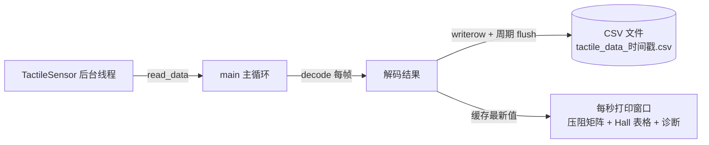

## 需求概述
在触觉传感器采集程序 `Hall_R/main.py` 中增加 CSV 数据记录功能，将每帧读取的数据保存到磁盘，供后续离线分析。

## 已确认的功能细节
- **记录粒度**：每个有效回复帧写一行（约 200 行/秒），保留完整时间序列
- **CSV 列结构**（共 99 列，列名已按用户要求调整）：
  - `timestamp_ms`：帧时间戳，直接使用 `read_data()` 返回的 `timestamp_ms`（tactile_sensor.py 中已实现：采集启动起从 0 开始的毫秒间隔，`perf_counter_ns` 差值），不用真实时间
  - 78 列压阻数据：`ch1` ~ `ch78`（行优先，与现有 `format_piezoresistance` 顺序一致）
  - 20 列 Hall 数据：4 个传感器 × 5 个字段，列名为 `hN_t`（温度C）、`hN_bx`、`hN_by`、`hN_bz`、`hN_mag`（模长，单位 G），N=1~4
- **文件命名**：自动带时间戳，如 `tactile_data_20261119_153000.csv`，每次运行生成新文件，不覆盖旧数据
- **终端打印**：保留现有每秒打印压阻矩阵、Hall 表格与故障诊断逻辑，CSV 保存与之共存
- **附带健壮性**：主循环取帧与打印窗口共用解码结果，顺带规避已知的 `latest_response_payload` 为 `None` 的竞态（decode 前加保护，不重构现有诊断架构）

## 视觉效果
无 UI 变化，仅数据落盘功能；终端输出保持不变，可在启动时额外打印一行 CSV 文件路径提示。

## 技术栈
- Python 3 标准库 `csv` + `time`，无新增第三方依赖
- 复用现有 `tactile_sensor.py` 的 `decode()`（返回压阻 list[78] 与 Hall list[4×dict]），不修改采集模块

## 实现方案
### 总体策略
在 `main.py` 的主循环中，将"每秒窗口解码一次"改为"每帧解码一次"，解码结果同时用于两个用途：立即写入 CSV 一行 + 缓存为最新数据供每秒打印窗口复用。这样避免同一数据重复解码，也消除了原来"打印时才 decode"导致的 `None` 竞态。

### 关键设计决策
1. **写入位置**：主循环每轮 `read_data()` 成功后立即 `decode` 并 `writerow`。主循环本身以极快速度轮询，写入在锁外进行，不占用 `_buffer_lock`，不影响采集线程实时性。
2. **性能**：每帧解码为 `struct.unpack` 78 个 uint16 + 4 次 8 字节解包（微秒级），`csv.writerow` 配合 `open()` 默认缓冲（8KB），200 Hz 写入无瓶颈；每秒打印窗口时 `flush()` 一次，保证异常退出时最多丢 1 秒数据。
3. **错误处理**：文件在 `try` 块前创建，`finally` 中关闭；decode 前增加 `latest_response_payload is None` 保护分支（复用已建修复计划中的方案，重置窗口状态并 `continue`）。
4. **代码组织**：新增两个辅助函数（列头生成、单行数据组装），主循环逻辑改动最小化，不触碰 `tactile_sensor.py`。

### CSV 行格式
- 时间戳：`f"{timestamp_ms:.3f}"`（毫秒，3 位小数，从 0 开始）
- 压阻：整数原值
- Hall：物理量保留 4 位小数（`f"{value:.4f}"`）
- 表头首行写入列名，列顺序 = 行数据顺序
- 列名映射：`hN_t` ← dict["temperature_c"]，`hN_bx` ← dict["magnetic_x_gauss"]，`hN_by` ← dict["magnetic_y_gauss"]，`hN_bz` ← dict["magnetic_z_gauss"]，`hN_mag` ← dict["magnetic_magnitude_gauss"]

## 架构设计


## 目录结构
```
Hall_R/
└── main.py  # [MODIFY] 唯一修改文件
```
main.py 内改动点：
- 顶部：`import csv`
- 新增函数 `build_csv_header()`：生成 99 列表头（timestamp_ms, ch1~ch78, h1_t...h4_mag）
- 新增函数 `make_csv_row(timestamp_ms, piezoresistance_data, hall_data)`：组装单行字符串列表
- `main()`：主循环前创建 CSV 文件并写表头；主循环内每帧 decode→writerow，decode 前加 None 保护；打印窗口复用缓存的解码结果并 flush；`finally` 关闭文件